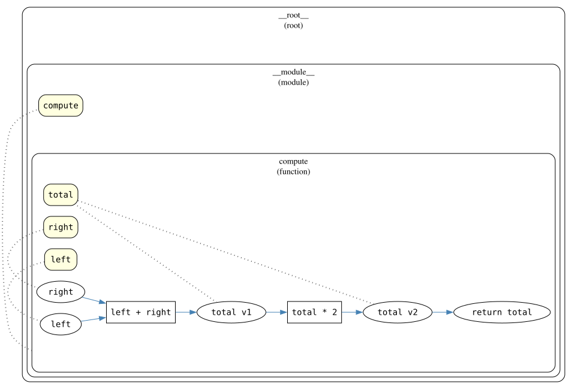

# Depencity

Experimental static analyzer for measuring the complexity of data dependencies in Python code.
It supports agentic refactoring by guiding LLMs toward the required dependency topology.

On this page:

- [Install](#install)
- [Quick start](#quick-start)
- [Export a graph](#export-a-graph)
- [Analyze a package](#analyze-a-package)
- [Read a profile](#read-a-profile)
- [Use from Python](#use-from-python)
- [Use with an MCP client](#use-with-an-mcp-client)
- [Analysis boundaries](#analysis-boundaries)
- [Contributing and support](#contributing-and-support)
- [Custom Graph Model](#custom-graph-model)
- [AI assistance](#ai-assistance)

Depencity builds a static dependency graph for comparing code structure. It
represents bindings, values, individual operations, and conditions.
See the [graph model](https://github.com/vdmk/depencity/blob/v0.1.0/docs/graph-model.md)
and [analysis boundaries](https://github.com/vdmk/depencity/blob/v0.1.0/docs/analysis-boundaries.md).

The graph structure is not set in stone and is subject to change. Think of it as
a profile of a particular code version that can be recomputed at any time,
rather than a fixed contract.

The ultimate goal is to create a long-running agentic loop that reduces
accidental complexity. Agents can use the MCP tool to repeatedly measure and
refactor code until they reach chosen metric targets.
Agents can work toward a chosen graph topology: reduce data dependencies
or concentrate complexity inside low-level
abstractions, leaving higher levels to orchestrate them.

Depencity currently provides graphs and profiles through a CLI, Python API, and
MCP server.


## Install

Requires Python 3.14+. Install as a regular Python package; these examples use
[uv](https://docs.astral.sh/uv/getting-started/installation/).

```bash
uv tool install --python 3.14 depencity
```

Installation provides the `depencity` and `depencity-mcp` commands.

## Quick start

Profile a Python file:

```bash
depencity profile path/to/file.py --depth 0
```

The profile reports reads, writes, calls, and dependency paths.
`--depth 0` shows the root’s aggregate across all scopes. Add `--format json`
for JSON output.

See [Read a profile](#read-a-profile) for scope aggregation and interpretation,
[Analyze a package](#analyze-a-package) for source layout and import naming,
or [compare a refactoring](https://github.com/vdmk/depencity/blob/v0.1.0/docs/refactoring.md)
for a worked before/after example.

For more commands and troubleshooting, see the [usage guide](https://github.com/vdmk/depencity/blob/v0.1.0/docs/usage.md).

## Export a graph

Depencity exports graphs as JSON or Graphviz DOT. This graph represents the
[example source](https://github.com/vdmk/depencity/blob/v0.1.0/docs/cases-examples/readme-example.py):

The addition feeds the first value of `total`, which feeds the multiplication.
Reassigning `total` creates a second value version rather than replacing the
first node:



[Source](https://github.com/vdmk/depencity/blob/v0.1.0/docs/cases-examples/readme-example.py)

The profile measures this structure, including reads, writes, and dependency
path lengths. See [model examples](https://github.com/vdmk/depencity/blob/v0.1.0/docs/model-cases.md)
for complete exported graphs, including conditions, calls, and mutations.

See [graph export instructions](https://github.com/vdmk/depencity/blob/v0.1.0/docs/usage.md#export-a-graph)
for commands and Graphviz rendering.

## Analyze a package

```bash
depencity profile path/to/package --depth 1
```

The target directory name determines the module prefix. If the checkout name
differs from the importable package name, target the package directory itself.
See [package analysis](https://github.com/vdmk/depencity/blob/v0.1.0/docs/usage.md#analyze-a-package)
for source layouts, `--source`, and explicit package naming through the Python API.

## Read a profile

Profiles report reads, writes, calls, and dependency paths by scope. Each scope’s
profile includes its descendants; `--include-own-profile` also shows that scope
alone. `--depth` limits displayed detail without changing aggregate measurements.

Compare the same target and options before and after a refactoring. Inspect
scope counts, path counts and lengths, and cycles together: shorter paths alone
do not establish an improvement.

See [profile interpretation](https://github.com/vdmk/depencity/blob/v0.1.0/docs/interpreting-profiles.md)
for details, [compare a refactoring](https://github.com/vdmk/depencity/blob/v0.1.0/docs/refactoring.md)
for a worked example, or [metric definitions](https://github.com/vdmk/depencity/blob/v0.1.0/docs/metrics.md)
for exact counting rules.

## Use from Python

See the [Python API reference](https://github.com/vdmk/depencity/blob/v0.1.0/docs/python-api.md) for library installation,
builders, profiling, graph exports, and public types.

## Use with an MCP client

Configure your client to launch `depencity-mcp --workspace /absolute/path/to/project`
over stdio. The server exposes a `profile` tool for files and packages inside
that workspace.

See [MCP setup](https://github.com/vdmk/depencity/blob/v0.1.0/docs/usage.md#use-with-an-mcp-client)
for configuration, a first request, tool parameters, and workspace rules.

## Analysis boundaries

Depencity parses code without executing it. It models statically visible
dependencies, with approximations for name lookup, imports, calls, control flow,
and mutation. Type annotations supply member-resolution hints rather than data
dependencies; imports used only in annotations may be omitted.

It does not simulate runtime values, dynamic dispatch, individual function
invocations, or a complete shared heap. Conditions gate operations but do not
form a complete control-flow model. Unsupported syntax or source layouts may
raise an error; see the documented boundaries before interpreting a result.

- [Graph model](https://github.com/vdmk/depencity/blob/v0.1.0/docs/graph-model.md): nodes, edges, scopes, and dependency meaning.
- [Model examples](https://github.com/vdmk/depencity/blob/v0.1.0/docs/model-cases.md): source examples and graph illustrations.
- [Analysis boundaries](https://github.com/vdmk/depencity/blob/v0.1.0/docs/analysis-boundaries.md): supported behavior,
  approximations, and fallbacks.

## Contributing and support

Report bugs or propose features in [GitHub Issues](https://github.com/vdmk/depencity/issues).
For development instructions, see [Contributing](https://github.com/vdmk/depencity/blob/v0.1.0/CONTRIBUTING.md).
Release history is in the [Changelog](https://github.com/vdmk/depencity/blob/v0.1.0/CHANGELOG.md).

MIT licensed. See [LICENSE](https://github.com/vdmk/depencity/blob/v0.1.0/LICENSE).

## Custom Graph Model

Standard [dependence graph](https://llvm.org/docs/DependenceGraphs/index.html#dependence-graphs-in-llvm)
models include the data dependence graph (DDG), which represents how operations
depend on data, and the program dependence graph (PDG), which represents both
data dependencies and the conditions that determine whether operations execute.
These models are used in compiler
optimizations and security analysis. Code-analysis tools also use definition/use
semantics to query where values are defined and used.

Depencity intentionally diverges from these approaches to focus on human-level
semantics for understanding code complexity. It uses a nested graph organized
by scope, its own read/write semantics, and a unified model of dependencies
through values and conditions. These choices support comparing code structure
and guiding refactoring rather than reproducing a standard dependence model.

## AI assistance

This project is built with Claude and Codex. Internal modules still retain their
original complexity. They were generated and refactored by OpenAI Luna/Sol with minimal human oversight. Think of it as
vibecoding constrained by Python code fixtures and expected JSON outputs. The plan
is to use Depencity in an agentic loop to simplify its own code automatically.
